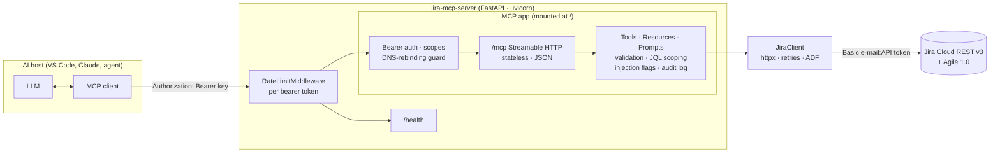

# Jira MCP Server (FastAPI + Python)

An MCP server that lets AI assistants (VS Code Copilot Chat, Claude, custom agents) work with **Jira Cloud**
through the official **MCP Python SDK 2.3** (`MCPServer`), hosted in **FastAPI** over Streamable HTTP.

It is a companion to the .NET `EmployeeKnowledgeAssistant` sample and follows the same security model
(see `../EmployeeKnowledgeAssistant/docs/LEARN-MCP.md` for the concepts).

## What it exposes

| Kind | Name | Jira API | Scope |
|---|---|---|---|
| Tool | `search_issues(jql, max_results, next_page_token)` | `POST /rest/api/3/search/jql` | read |
| Tool | `get_issue(issue_key, include_comments)` | `GET /rest/api/3/issue/{key}` + `/comment` | read |
| Tool | `list_projects(query)` | `GET /rest/api/3/project/search` | read |
| Tool | `get_transitions(issue_key)` | `GET /rest/api/3/issue/{key}/transitions` | read |
| Tool | `find_users(query)` | `GET /rest/api/3/user/search` | read |
| Tool | `get_active_sprint(board_id)` | `GET /rest/agile/1.0/board/{id}/sprint`, `/sprint/{id}/issue` | read |
| Tool | `create_issue(project_key, summary, issue_type, description, priority, labels)` | `POST /rest/api/3/issue` | **write** |
| Tool | `add_comment(issue_key, body)` | `POST /rest/api/3/issue/{key}/comment` | **write** |
| Tool | `transition_issue(issue_key, transition)` | `POST /rest/api/3/issue/{key}/transitions` | **write** |
| Tool | `assign_issue(issue_key, account_id)` | `PUT /rest/api/3/issue/{key}/assignee` | **write** |
| Resource | `jira://projects` | project list (JSON) | read |
| Resource template | `jira://issue/{issue_key}` | issue as Markdown | read |
| Resource | `jira://guides/jql` | JQL cheat sheet for the model | read |
| Prompt | `bug_triage(issue_key)` | triage workflow (read-only) | read |
| Prompt | `sprint_report(board_id, audience)` | sprint status report | read |

Every tool returns **structured output** (Pydantic models → JSON Schema). Read tools carry `readOnlyHint`,
write tools don't, so hosts like VS Code ask for confirmation before writes.

## Architecture



Two separate credentials: **MCP clients** authenticate to this server with bearer keys (scopes `jira:read`,
`jira:write`); **this server** authenticates to Jira with a service account's e-mail + API token, which the model never sees.

## Project structure

```
JiraMcpServer/
├── pyproject.toml              # deps, console scripts, pytest config
├── .env.example                # all settings, with demo keys
├── Dockerfile · docker-compose.yml · .dockerignore
├── src/jira_mcp/
│   ├── app.py                  # FastAPI app, lifespan, mounting, /health, entry point
│   ├── server.py               # MCPServer: tool / resource / prompt registration
│   ├── jira_client.py          # async Jira REST client, error mapping, retries, ADF <-> text
│   ├── models.py               # Pydantic output models + mappers (no e-mails returned)
│   ├── security.py             # bearer-key verifier, scopes, validation, JQL scoping,
│   │                           #   prompt-injection flags, rate limiter, key-hash CLI
│   ├── config.py               # pydantic-settings (env / .env)
│   ├── logging_config.py       # text or JSON logs, audit() context manager
│   └── client_demo.py          # small MCP client CLI
└── tests/
    ├── fake_jira.py            # in-memory Jira (httpx.MockTransport)
    ├── conftest.py             # real uvicorn server in a thread + real MCP client
    ├── test_security.py        # validation, JQL scoping, injection, verifier
    ├── test_jira_client.py     # endpoints, retries, error mapping, ADF
    └── test_mcp_e2e.py         # every tool/resource/prompt, scopes, 401/403/429, read-only mode
```

## Setup

Requires **Python 3.11+**.

```powershell
cd D:\Repos\AI-Repo\MCP\JiraMcpServer
python -m venv .venv
.\.venv\Scripts\Activate.ps1          # bash: source .venv/bin/activate
pip install -e ".[dev]"
copy .env.example .env                # bash: cp .env.example .env
```

Edit `.env`:

1. `JIRA_BASE_URL`, `JIRA_EMAIL`, `JIRA_API_TOKEN`: create the token at
   <https://id.atlassian.com/manage-profile/security/api-tokens>. Prefer a dedicated service account with access only to the projects you need.
2. `JIRA_ALLOWED_PROJECTS`: e.g. `["ENG","OPS"]`.
3. `READ_ONLY=true` to start; set `false` when you want write tools.
4. `MCP_API_KEYS`: the demo keys `dev-reader-key` (read) and `dev-writer-key` (read+write) are preconfigured.
   Generate real ones with `jira-mcp-hash-key` (prints a random key and its hash) and put only the hash in `.env`.

## Run

```powershell
jira-mcp-server                        # or: python -m jira_mcp.app
# -> http://127.0.0.1:8000/mcp   health: http://127.0.0.1:8000/health
```

Try it with the bundled client (second terminal, venv activated):

```powershell
$env:MCP_API_KEY = "dev-reader-key"
jira-mcp-demo list                     # what the server offers (tools, resources, prompts)
jira-mcp-demo projects                 # these need real Jira credentials in .env
jira-mcp-demo search ""                # recent issues in the allowed projects
jira-mcp-demo search "statusCategory != Done ORDER BY updated DESC"
jira-mcp-demo issue ENG-42
jira-mcp-demo sprint 12
jira-mcp-demo guide
```

Or with **MCP Inspector**: `npx @modelcontextprotocol/inspector` → Streamable HTTP → `http://localhost:8000/mcp`
→ header `Authorization: Bearer dev-reader-key`.

## Add to VS Code Chat

Add to `.vscode/mcp.json` (alongside the employee server if you like):

```json
{
  "inputs": [
    { "id": "jiraMcpKey", "type": "promptString", "description": "Jira MCP key (dev-reader-key / dev-writer-key)", "password": true }
  ],
  "servers": {
    "jira": {
      "type": "http",
      "url": "http://localhost:8000/mcp",
      "headers": { "Authorization": "Bearer ${input:jiraMcpKey}" }
    }
  }
}
```

Click **Start**, enter the key, open Chat in **Agent** mode, and ask e.g. *"What open bugs are in ENG?"*,
*"Summarise ENG-42 and its comments"*, or type `/` → `mcp.jira.bug_triage`.

## Docker

```powershell
docker compose up --build              # reads .env, serves http://localhost:8000/mcp
# or
docker build -t jira-mcp-server .
docker run --rm -p 8000:8000 --env-file .env -e HOST=0.0.0.0 jira-mcp-server
```

The image runs as a non-root user, has a health check, and logs JSON lines.

## Tests

```powershell
pytest -q
```

64 tests, no real Jira needed: a fake Jira sits behind `httpx.MockTransport`, and the tests start the real
FastAPI app under uvicorn and connect with the SDK's real MCP client. They cover all tools, resources and prompts,
scope enforcement, read-only mode, project allow-listing, JQL break-out attempts, injection flagging,
PII minimisation, retries on 429/503, 401/403/429 at the HTTP layer and DNS-rebinding protection.

## Security design

| Risk | Control |
|---|---|
| **Authentication** | `Authorization: Bearer` verified by the SDK's auth middleware via `StaticApiKeyVerifier` (SHA-256 hashes, constant-time compare). 401 responses advertise OAuth protected-resource metadata, so replacing the verifier with a JWT verifier for Entra ID/Okta is a drop-in change. |
| **Authorization** | `jira:read` required for everything (403 otherwise); `jira:write` checked inside each write tool; `READ_ONLY` kill switch; `JIRA_ALLOWED_PROJECTS` enforced on keys, JQL and results. |
| **Tool abuse** | Strict argument validation (issue/project keys, lengths, labels), schema limits (`max_results ≤ 100`), per-key rate limit, write tools need confirmation in the host. |
| **JQL injection** | Model JQL is wrapped as `project in (...) AND (<jql>)`; unbalanced parentheses/quotes are rejected and results are filtered again by project. |
| **Prompt injection** | Issue text is cleaned of hidden characters, truncated, and flagged in `content_warnings`; prompts and tool descriptions say issue text is data. |
| **Data leakage** | Only display names (no e-mails), only allowed projects, "not found" for hidden projects, sanitised Jira errors (no credentials echoed), audit logs record IDs and outcomes, never payloads. |
| **DNS rebinding** | SDK `TransportSecuritySettings` Host/Origin allow-lists (`MCP_ALLOWED_HOSTS`, `MCP_ALLOWED_ORIGINS`). |

**Note:** Jira permissions apply to the *service account*, not the end user. For per-user permissions, use
OAuth 2.0 (3LO) to Atlassian and call Jira with each user's token instead.

## Troubleshooting

| Symptom | Fix |
|---|---|
| 401 from `/mcp` | Send `Authorization: Bearer <key>`; check the hash in `MCP_API_KEYS`. If the server log says *No MCP_API_KEYS configured*, `.env` wasn't found: it must be in the project folder (the startup log prints which configuration files were loaded) |
| 403 from `/mcp` | The key lacks `jira:read` |
| 421/400 "Invalid Host header" | Add your host name to `MCP_ALLOWED_HOSTS` (e.g. behind a proxy or in Docker) |
| Tool error "credentials are not permitted" | Wrong `JIRA_EMAIL`/`JIRA_API_TOKEN`, or the account lacks project permission |
| Write tool says read-only | Set `READ_ONLY=false` and use a key with `jira:write` |
| Search returns nothing | Check `JIRA_ALLOWED_PROJECTS`; the executed JQL is returned in the `jql` field |
